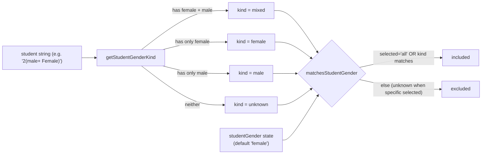

## Plan: Student Gender Filter

Add a new Student Gender filter to `src/App.jsx` mirroring the existing `Teacher Preference` pattern, but adapted for the messy `student` string (e.g. `"1 ( Female)"`, `"2(male+ Female)"`, `"1male"`, `"1"`). The filter is loose (any-match), exposes `All / Female / Male / Mixed`, and defaults to `female`.

**Steps**
1. Add a `studentGender` state hook next to `teacherPreference`, defaulting to `'female'` (parallel with the existing `Teacher Preference` default of `'male'`).
2. Add a `getStudentGenderKind(student)` helper (top-level, next to `getDaysPerWeek`) that returns `'female'`, `'male'`, `'mixed'`, or `'unknown'` by case-insensitively scanning the string for the tokens `female` and `male`. Mixed is detected when both tokens appear (any order, regardless of separators like `+`, `,`, ` `). Pure single-gender strings with only one token (e.g. `"1male"`, `"Female "`) return that gender. Values like `"1"` with neither token return `'unknown'`.
3. In the `useMemo` filter block, add a `matchesStudentGender` check: if `studentGender === 'all'`, match; otherwise compare the parsed kind to the selected value. Records whose kind is `'unknown'` are excluded only when a specific gender (not `'all'`) is selected — this matches the loose/any-match contract.
4. Add `studentGender` to the `useMemo` dependency array so the filter recomputes when it changes.
5. Reset `studentGender` to `'female'` inside `resetFilters`.
6. Add a `Student Gender` `<select>` to the filter grid (right after the `Teacher Preference` block in `src/App.jsx`), reusing the same Tailwind classes and `disabled={loading}` pattern. Options: `All`, `Female`, `Male`, `Mixed` with values `all`, `female`, `male`, `mixed`.

**Relevant files**
- `src/App.jsx` — add state, helper, filter logic, dependency, reset entry, and the new `<select>` control. Reuse the exact Tailwind className and `disabled={loading}` pattern used by the `Teacher Preference` select (~lines 180–190).

**Diagrams**

**Verification**
1. With `studentGender = 'female'`, confirm only cards where the `student` text mentions `female` are shown (mixed records pass via any-match, unknowns are excluded).
2. Switch to `'male'` and confirm the count changes accordingly; `'mixed'` should only show entries with both tokens.
3. `'all'` should restore the original count (modulo other active filters).
4. Click `Reset Filters` — `studentGender` should return to `female`.
5. Toggle `loading` state — the new select should disable like the other controls.
